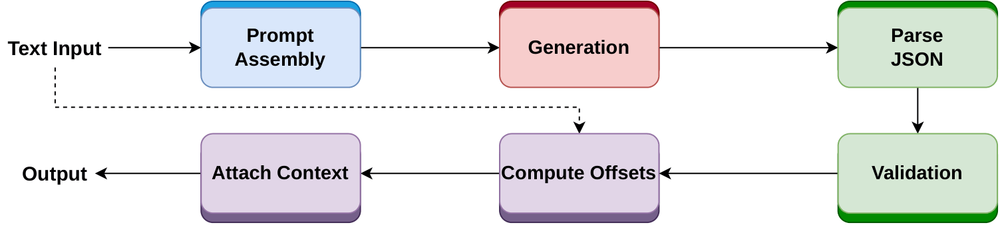
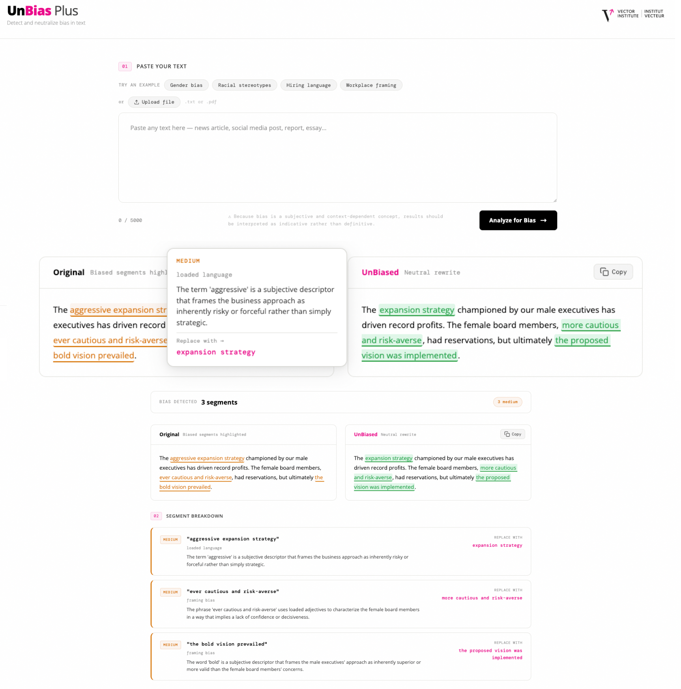

# Summary

Bias in natural language remains a persistent challenge in both human-written and artificial intelligence (AI) generated content, affecting domains such as journalism, education, and AI research, where Biased wording can shape how people and groups are represented, often through subtle word choices rather than overtly harmful content. Existing detection methods identify only whether bias is present, with limited support for granular detection, interpretable explanations, neutral rewriting, and openly available trained models. To address those limitations, UnBias-Plus is an open-source Python toolkit that unifies (1) segment-level multi-class bias classification, (2) biased span localization, (3) neutral text rewriting, and (4) reasoning for each decision. It is built on large language models (LLMs) fine-tuned on a curated, annotated bias dataset [@unbias-plus-dataset], and returns, for each biased phrase, what kind of bias it shows, why, and a neutral alternative.
The toolkit is available through a Python API, a command-line interface (CLI), and a REST API for developers, and an interactive web interface for non-technical users. The source code, models, datasets, and documentation are publicly available, supporting reproducible fairness research and practitioner-facing bias review workflows.

# Statement of Need

Bias in natural language can influence how people and groups are represented, interpreted, and treated across human-written and AI-generated content [@gallegos2024bias]. Earlier text-bias research commonly framed the problem as binary or multi-class classification tasks, including sentence-level bias detection, span-level identification, and neutral rewriting from annotated examples [@gallegos2024bias]. Generative AI broadens this challenge because outputs are open-ended, context-dependent, and shaped by the prompt and intended use, while commercial moderation APIs [@openai_moderation_api] and LLM guardrails [@inan2023llama] can flag content against predefined safety policies or risk taxonomies, they are generally designed for broad safety enforcement rather than detailed bias analysis. Furthermore, many widely used moderation solutions are proprietary, while open alternatives often focus on safety classification rather than explaining and mitigating bias.

UnBias-Plus addresses this need as an open-source Python toolkit for fine-grained bias analysis and rewriting. It provides fine-tuned models trained on a purpose-built annotated dataset and supports reproducible end-to-end workflows for bias detection, explanation, and neutral rewriting. It supports both technical and non-technical users, enabling integration into research, development, and practitioner-facing review processes in domains such as journalism, education, and content moderation.

# State of the field

Several widely used fairness toolkits have emerged in this space, such as AI Fairness 360 (AIF360) [@bellamy2019aif360] which provides a comprehensive suite for detecting and mitigating disparities across preprocessing, in-processing, and post-processing stages, and Fairlearn [@weerts2023fairlearn] that focuses on practical fairness constraints for ML models, but both are mainly designed for traditional ML settings.
Also, a number of open-source tools have been proposed for linguistic bias detection. For instance, Dbias [@raza2022dbias], NBias [@raza2024nbias], and Biaslyze [@biaslyze_api] identify biased expressions in text; however, these approaches largely rely on encoder-only architectures, often operate in an NLTK-style preprocessing pipeline, and do not natively leverage natural language inference or LLMs. NeuTral Rewriter [@vanmassenhove2021neutral] rewrites gendered English sentences into gender-neutral alternatives, but addresses a single bias dimension and does not detect or explain bias. Lastly, newer frameworks such as LangFair [@bouchard2025langfair] and FairLangPro [@manerba2025fairlangproc] adopt LLM-native, prompt-based strategies, but typically focus on individual tasks.
Rather than extending these tools, UnBias-Plus was built as a unified pipeline because they offer limited support for granular detection, interpretable explanations, neutral rewriting, and openly available trained models together.


# Software Design

UnBias-Plus implements a multi-stage bias review pipeline as shown in \autoref{fig:pipeline}. Given input text, the system prompts a fine-tuned language model to produce a structured analysis. The analysis includes whether bias is present, relevant spans with character-level offsets, bias types, severity scores, explanations, and suggested neutral replacements. For each detected segment, the output includes the original phrase, bias type, severity, explanation, and replacement, alongside a full neutral rewrite for holistic comparison. Results can be displayed in the web interface (\autoref{fig:ui_demo}), printed via the command line, or exported as JSON for annotation, evaluation, dataset construction, and downstream model retraining.

To support different communities and needs, we separate different user interfaces by design. For developers, the toolkit exposes three programmatic entry points over a shared pipeline implementation: a Python API, a CLI, and a REST API served via FastAPI. The CLI accepts raw text strings or plain-text files, requiring no application code. For non-technical practitioners such as journalists, educators, and content reviewers, invoking `unbias-plus --serve` launches both the `/analyze` REST endpoint and an interactive web interface simultaneously, accessible from any browser without additional configuration as shown in \autoref{fig:ui_demo}. The web interface presents bias severity through color-coded highlighting and provides per-segment reasoning, surfacing the toolkit's output in a form that requires no programming expertise to interpret.





The toolkit supports training with any instruction-tuned model; however, the default configuration uses Qwen3-8B [@@unbias-plus-8b], fine-tuned with low-rank adaptation (LoRA). The design prioritizes accessibility under limited computational resources by releasing a compact Qwen3.5-4B variant [@unbias-plus-4b]. Both variants support 4-bit quantization, reducing peak GPU memory usage and enabling deployment on consumer-grade hardware without requiring code changes. Additionally, users can substitute any Hugging Face–compatible checkpoint via a custom model path, allowing domain-specific adaptation without modifying the pipeline.

```python
from unbias_plus import UnBiasPlus

pipe   = UnBiasPlus()
result = pipe.analyze(
    "The aggressive expansion strategy championed by "
    "our male executives has driven record profits."
)

print(result.binary_label)       # "biased"
print(result.severity)           # 3

for seg in result.biased_segments:
    print(seg.original, seg.bias_type, seg.replacement, seg.start, seg.end)
# "aggressive expansion strategy"      opinion_as_fact          "expansion strategy"       4  33
# "championed by our male executives"  stereotypical_association "advocated by executives"  34 67

print(result.unbiased_text)
# "The expansion strategy advocated by executives has driven record profits."
```

The `start` and `end` offsets in the listing are computed deterministically after JSON parsing by locating each segment in the original text, rather than by a secondary span-tagging model, so every replacement stays anchored to its source position regardless of tokenization.

# Research Impact Statement

The research impact of UnBias-Plus spans research, industry, and societal dimensions. From a research perspective, it contributes a unified framework for bias detection, classification, explanation, and debiasing, together with released models, code, datasets, and training recipes that support reproducible development of fairness-aware language systems.
In industry, UnBias-Plus can be applied across domains such as journalism, content moderation, and decision-support systems, where editorial and review teams can use it to screen biased or non-neutral language and improve transparency. In high-stakes domains such as hiring and insurance, it can help flag potentially biased language before documents are published or decisions are communicated.
At the societal level, UnBias-Plus can support more equitable information dissemination by reducing the propagation of biased language in public-facing systems, and can be used in educational settings to help students identify and refine biased expressions in their writing.

## Validation

Usage examples for the command-line interface, Python API, REST API, and web interface are provided in the documentation. To validate the released models, we evaluated them on text outside the training distribution and assessed whether their outputs support the intended bias review workflow. We used an out-of-distribution test set from BABE [@spinde-etal-2021-neural-media], a news media dataset, taking a stratified sample of 175 biased and 175 unbiased samples. GPT-4o-mini was used as a judge on a 0–5 scale, alongside automatic metrics including recall at biased words, ROUGE-L, length ratio, hallucination rate, and duplicate rate. The prompts for the judge metrics are given in our codebase.

: Out-of-distribution evaluation on BABE. $\uparrow$ = higher is better, $\downarrow$ = lower is better, $\approx 1$ = closest to 1.0 is best. Judge scores are on a 0–5 scale. \label{tab:ood-validation}

| Sample set | Metric | Qwen3.5-4B UnBias+ | Qwen3-8B UnBias+ |
|:-----------|:-------|-------------------:|-----------------:|
| Biased     | Bias reduction (%) $\uparrow$                | 57.5     | **60.6** |
|            | Bias reduction (mean) $\uparrow$             | 1.91     | **1.94** |
|            | Semantic relevance $\uparrow$                | 4.09     | **4.18** |
|            | Global rewrite quality $\uparrow$            | **3.15** | 3.08     |
|            | ROUGE-L $\uparrow$                           | 0.71     | **0.72** |
|            | Length ratio $\approx 1$                     | **1.00** | 0.99     |
| Unbiased   | Correct identification (mean) $\uparrow$     | 3.44     | **4.16** |
|            | Correct identification (median) $\uparrow$   | 2.0      | **5.0**  |
|            | Avoids needless rewrites (mean) $\uparrow$   | 3.97     | **4.44** |
|            | Avoids needless rewrites (median) $\uparrow$ | 3.0      | **5.0**  |
| Segment    | Recall at biased words $\uparrow$            | **0.85** | 0.71     |
|            | Segment edit quality $\uparrow$              | **3.88** | 3.58     |
|            | Hallucination rate (%) $\downarrow$          | 5.3      | **3.6**  |
|            | Duplicate rate (%) $\downarrow$              | **0.0**  | 0.7      |

Results in \autoref{tab:ood-validation} show a trade-off between bias detection and preservation on one side and segment-level editing precision on the other. The fine-tuned Qwen3-8B UnBias-Plus achieves stronger bias reduction, higher relevance, stronger preservation of unbiased samples, and a lower hallucination rate. The fine-tuned Qwen3.5-4B UnBias-Plus, however, improves rewrite and segment-level behaviour, with higher global rewrite quality, higher recall at biased words, stronger segment replacement quality, and a zero duplicate rate. These results support the design of UnBias-Plus as a configurable toolkit: users can select a model variant depending on whether their workflow prioritizes conservative bias review, unbiased-text preservation, or more aggressive segment-level localization.

# Focused Use Cases

UnBias-Plus targets practitioners across several domains, starting with editorial teams, who can review drafts before publication: the toolkit highlights biased phrases, explains each issue, and suggests neutral rewrites, reducing the time required for manual bias review at scale. HR and policy teams can apply the same pipeline to job postings and internal documents before wider distribution, and NLP and fairness researchers can use the toolkit for dataset construction and benchmarking. Developers can integrate bias detection directly into existing pipelines using the same interface. Because bias is context-dependent, the toolkit is designed to support human-in-the-loop review, where model outputs can be inspected, contested, and revised before use in editorial, research, or decision-support workflows.

# Limitations and Future Development

UnBias-Plus should be used as a bias review assistant rather than as a final authority on neutrality or fairness. Bias is context-dependent: the same phrase may be interpreted differently across domains, communities, and cultural settings. For this reason, the toolkit is designed to support human-in-the-loop review, where model outputs can be inspected, contested, and revised before use in editorial, research, or decision-support workflows.
From a practical perspective, the amount of context that can be processed depends on the selected model and available hardware. While the released 4B and 8B variants make the toolkit easier to deploy, smaller models may still miss subtle framing patterns or produce incomplete reasoning for complex articles. Domain sensitivity is another limitation: adapting the toolkit to a custom domain requires retraining the models, for which we provide the training code.
Future development will focus on expanding domain coverage, improving multilingual support, and extending UnBias-Plus beyond text toward image and multimodal analysis [@raza2025humanibench; @radwan2026sonico1], where bias, framing, and manipulation can appear across visual as well as linguistic content.

# AI usage disclosure

ChatGPT was used for grammar and readability improvements in the paper text, and for AI-assisted code suggestions during development. All outputs were reviewed, edited, and validated by the human authors, who made all core design and architectural decisions.

# Acknowledgements

Resources used in preparing this research were provided, in part, by the Province of Ontario, the Government of Canada through CIFAR, and companies sponsoring the Vector Institute (http://www.vectorinstitute.ai/#partners). This research was funded by the European Union's Horizon Europe research and innovation programme under the AIXPERT project (Grant Agreement No. 101214389), which aims to develop an agentic, multi-layered, GenAI-powered framework for creating explainable, accountable, and transparent AI systems.
We thank Orli Namian, Natalie Richard, Marcie De Cesare, Kylie Williams, Sindhuja Chaduvula and Aravind Narayanan for their valuable support to the UnBias-Plus project.

# References